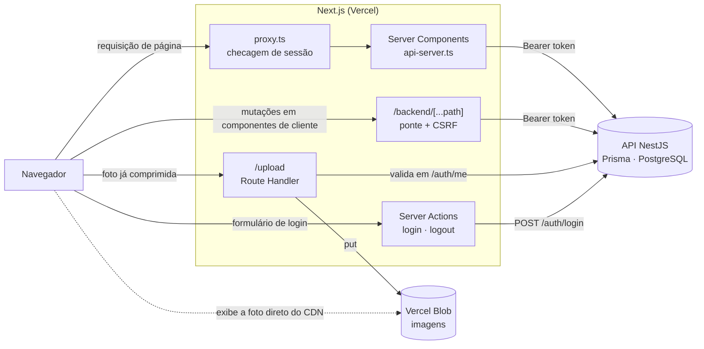
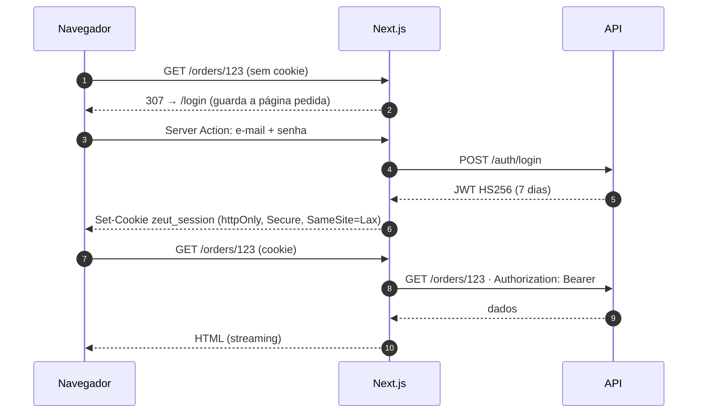
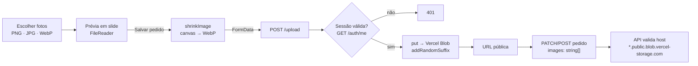

<div align="center">


# Zeut · Gestão de Encomendas — Web

Front-end do sistema de gestão de encomendas de uniformes e confecções.
Aplicação **Next.js 16 (App Router)** com renderização híbrida, autenticação por sessão em cookie `httpOnly`,


</div>
Painel priorizado de encomendas, alerta de atrasos, cadastro de clientes/responsáveis, formulário de pedido
com produtos por molde e grade de tamanhos, ciclo de vida do pedido, galeria de fotos, gestão de usuários com papéis,
modo escuro e instalação como aplicativo (PWA).

## Arquitetura


## Autenticação e sessão


## Upload de imagens


## Rotas

| Rota | Tipo | Acesso | Descrição |
|---|---|---|---|
| `/login` | Estática | Pública | Entrada; sem cadastro público |
| `/` | Dinâmica (PPR) | Logado | Resumo, alerta de atrasos, filtros e cards por prioridade, entregues |
| `/register` | Dinâmica | Logado | Cadastro de cliente · aba Responsável (`?tab=responsible`) |
| `/orders/new` | Dinâmica | Logado | Novo pedido (`?client=<id>` / `?responsible=<id>` pré-selecionam) |
| `/orders/[id]` | Dinâmica | Logado | Detalhe, ciclo de vida, galeria de fotos |
| `/orders/[id]/edit` | Dinâmica | Logado | Edição do pedido e das fotos |
| `/users` | Dinâmica | `ADMIN` | Criar, redefinir senha, mudar papel e excluir contas |
| `/offline` | Estática | Pública | Página do PWA sem conexão |
| `/session-expired` | Route Handler | — | Limpa o cookie e volta ao login |
| `/backend/[...path]` | Route Handler | Logado | Ponte para a API (bloqueia `auth/*`) |
| `/upload` | Route Handler | Logado | Envio de foto para o Vercel Blob |

##  Estrutura do projeto

```
src/
├── app/                      Rotas finas (composição + Suspense). Grupos: (app) logado · (auth) login
│   ├── backend/[...path]/    ponte navegador → API
│   ├── upload/               Route Handler do Vercel Blob
│   ├── session-expired/      limpeza de sessão
│   ├── manifest.ts · error.tsx · globals.css (tokens de tema)
├── components/
│   ├── layout/               header, navegação ativa, alternador de tema
│   └── ui/                   design system: button, card, badges, fields, steps, breadcrumb,
│                             back-button, confirm-dialog, toast
├── features/                 uma pasta por funcionalidade (isoladas entre si)
│   ├── auth/                 login, menu do usuário, navegação de admin
│   ├── users/                gestão de contas
│   ├── orders/
│   │   ├── components/       listagem, cards, filtros, detalhe, ciclo de vida, galeria (lightbox)
│   │   └── form/             formulário, produtos, seletor de pessoas, slide de upload
│   ├── clients/ · responsibles/ · molds/ · registration/
├── lib/                      api-core/server/client · session · token · image · format
│                             documents (CPF/CNPJ/telefone) · priority · types · cn
└── proxy.ts                  proteção das páginas
```
