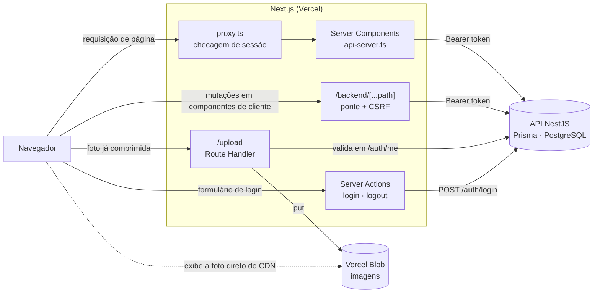
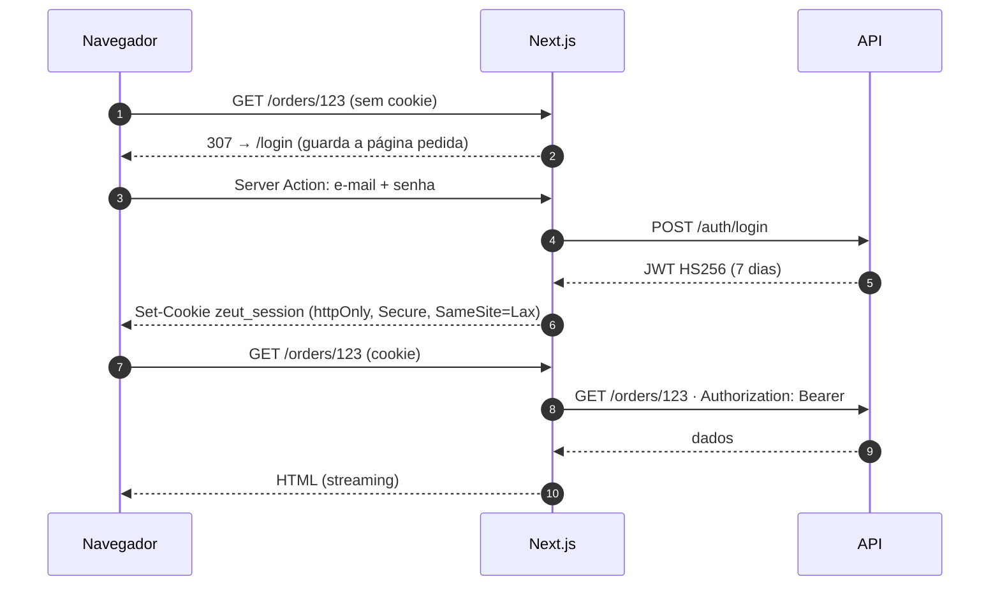
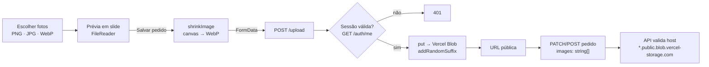

<div align="center">


# Zeut · Gestão de Encomendas — Web

Front-end do sistema de gestão de encomendas de uniformes e confecções.
Aplicação **Next.js 16 (App Router)** com renderização híbrida, autenticação por sessão em cookie `httpOnly`,


</div>


## 1. Visão geral

| | |
|---|---|
| **Domínio** | Pedidos de uniformes: clientes (PF/PJ/órgão público), responsáveis, moldes e grades de tamanho, produção e entrega |
| **Frontend** | Este repositório — Next.js 16, React 19, Tailwind CSS 4, TypeScript estrito |
| **Backend** | Repositório separado `zeut_gestao_api` — NestJS 12, Prisma 7, PostgreSQL (Neon) |
| **Infra** | Vercel (front e API como projetos distintos) · Neon (Postgres, `sa-east-1`) · Vercel Blob (imagens) |
| **Acesso** | Fechado: todas as rotas exigem login. Não há cadastro público; administradores criam as contas |

Funcionalidades: painel priorizado de encomendas, alerta de atrasos, cadastro de clientes/responsáveis, formulário de pedido
com produtos por molde e grade de tamanhos, ciclo de vida do pedido, galeria de fotos, gestão de usuários com papéis,
modo escuro e instalação como aplicativo (PWA).

## Arquitetura



**Decisões e motivos**

| Decisão | Motivo |
|---|---|
| Token JWT em cookie `httpOnly` e ponte `/backend/*` | O JavaScript da página nunca lê o token (mitiga roubo por XSS) e o navegador só conversa com a própria origem, sem CORS |
| Leitura de dados em **Server Components** dentro de `<Suspense>` | Menos JavaScript no cliente; o shell da página chega rápido e os dados fazem streaming |
| `features/*` isoladas, `app/` só compõe | Cada funcionalidade é removível; rotas ficam finas e testáveis |
| Compressão da imagem **no navegador** | Contorna o limite de ~4,5 MB do corpo de requisição da Vercel e reduz o armazenamento |
| Regras de negócio duplicadas (prioridade, datas) só para **feedback ao vivo** | A API continua sendo a fonte da verdade e revalida tudo |

## Autenticação e sessão



- **Sessão**: JWT HS256 (`jose`) com `issuer=zeut-api` e `audience=zeut-web`, guardado em cookie `httpOnly` + `Secure` (produção) + `SameSite=Lax`.
- **Papéis**: `USER` e `ADMIN`. O papel é conferido **no banco** a cada chamada, então rebaixar um usuário vale na hora para novas ações administrativas.
- **Redirecionamento pós-login**: a rota pedida fica no cookie `zeut_next`; `safeNext()` aceita só caminhos internos (proteção contra *open redirect*).
- **Token expirado ou inválido**: `/session-expired` (Route Handler) limpa o cookie e volta ao login.
- **Força bruta**: a API limita 5 tentativas por 15 min por IP + e-mail.

| Peça | Arquivo |
|---|---|
| Checagem otimista de sessão nas páginas | `src/proxy.ts` |
| Cookie de sessão, leitura e expiração | `src/lib/session.ts`, `src/lib/token.ts` |
| Cliente da API para Server Components (anexa o token) | `src/lib/api-server.ts` |
| Cliente da API para componentes de cliente (via `/backend`) | `src/lib/api-client.ts` |
| Ponte navegador → API, com checagem de `Origin` (CSRF) | `src/app/backend/[...path]/route.ts` |
| Login, logout e navegação de administração | `src/features/auth/` |
| Gestão de contas (somente `ADMIN`) | `src/features/users/` · `src/app/(app)/users/` |

> O `proxy.ts` só lê o cookie para evitar telas vazias. Quem protege os **dados** é a API, que valida a assinatura do token a cada requisição.

## Upload de imagens


## Rotas

| Rota | Tipo | Acesso | Descrição |
|---|---|---|---|
| `/login` | Estática | Pública | Entrada; sem cadastro público |
| `/` | Dinâmica (PPR) | Logado | Resumo, alerta de atrasos, filtros e cards por prioridade, entregues |
| `/register` | Dinâmica | Logado | Cadastro de cliente · aba Responsável (`?tab=responsible`) |
| `/orders/new` | Dinâmica | Logado | Novo pedido (`?client=<id>` / `?responsible=<id>` pré-selecionam) |
| `/orders/[id]` | Dinâmica | Logado | Detalhe, ciclo de vida, galeria de fotos |
| `/orders/[id]/edit` | Dinâmica | Logado | Edição do pedido e das fotos |
| `/users` | Dinâmica | `ADMIN` | Criar, redefinir senha, mudar papel e excluir contas |
| `/offline` | Estática | Pública | Página do PWA sem conexão |
| `/session-expired` | Route Handler | — | Limpa o cookie e volta ao login |
| `/backend/[...path]` | Route Handler | Logado | Ponte para a API (bloqueia `auth/*`) |
| `/upload` | Route Handler | Logado | Envio de foto para o Vercel Blob |

##  Estrutura do projeto

```
src/
├── app/                      Rotas finas (composição + Suspense). Grupos: (app) logado · (auth) login
│   ├── backend/[...path]/    ponte navegador → API
│   ├── upload/               Route Handler do Vercel Blob
│   ├── session-expired/      limpeza de sessão
│   ├── manifest.ts · error.tsx · globals.css (tokens de tema)
├── components/
│   ├── layout/               header, navegação ativa, alternador de tema
│   └── ui/                   design system: button, card, badges, fields, steps, breadcrumb,
│                             back-button, confirm-dialog, toast
├── features/                 uma pasta por funcionalidade (isoladas entre si)
│   ├── auth/                 login, menu do usuário, navegação de admin
│   ├── users/                gestão de contas
│   ├── orders/
│   │   ├── components/       listagem, cards, filtros, detalhe, ciclo de vida, galeria (lightbox)
│   │   └── form/             formulário, produtos, seletor de pessoas, slide de upload
│   ├── clients/ · responsibles/ · molds/ · registration/
├── lib/                      api-core/server/client · session · token · image · format
│                             documents (CPF/CNPJ/telefone) · priority · types · cn
└── proxy.ts                  proteção das páginas
```


##  Design system, tema e PWA

**Tema.** As cores são *design tokens* em `src/app/globals.css`: `:root` é o tema claro e `[data-theme="dark"]` o escuro. O alternador segue o
tema do sistema até haver escolha, que fica salva no aparelho. Use as classes semânticas (`bg-surface`, `text-ink`, `text-crimson-ink`, `text-ok-ink`…) e
**não** cores fixas como `bg-white`.

| Token | Valor (claro) | Origem |
|---|---|---|
| azul | `#0c1844` | logo |
| carmim | `#c80036` | logo |
| creme | `#fff5e1` | logo |
| coral | `#ff6969` | logo |

**Marca.** As logos originais ficam em `brand/` (não são publicadas). `npm run brand:build` (`scripts/generate-brand-assets.mjs`) gera a logo web,
o avatar do cabeçalho, a arte do login, os ícones do PWA, o `apple-icon` e o favicon.

**PWA.** `src/app/manifest.ts`, `public/sw.js` e `public/icons/`. Instalável (exige HTTPS, que a Vercel já fornece) e com página offline.

**Feedback.** `ToastProvider` fica no layout da área logada e sobrevive à troca de página (ex.: salvar e navegar para o pedido).
Sucesso some em 4,5 s e erro em 7 s; respeita `prefers-reduced-motion`.

